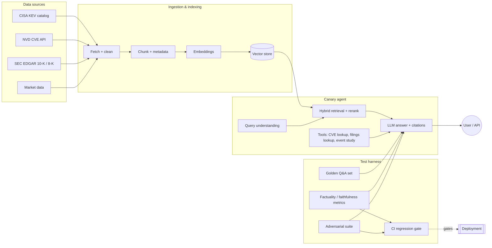

# 🐤 Canary

> **An AI-powered risk and compliance assistant for cybersecurity incidents, and the test harness that proves it can be trusted.**

Canary is a hands-on project where students build an AI-powered risk and compliance assistant that analyzes how cybersecurity incidents, ransomware, and vulnerabilities financially and operationally impact public companies. Students will create a production-grade retrieval-augmented generation (RAG) system using real security data (CVEs, CISA catalogs), financial filings (SEC 10-K risk factors, 8-K cyber disclosures), and market data, and then build a rigorous test harness to measure its factual accuracy and resilience to adversarial attack.

We build the **test harness alongside the agent**, and we **deploy both**.

---

## Why "Canary"?

Miners used canaries as an early-warning system for toxic air. Our assistant is an early-warning system for cyber risk, and our harness is the canary *for the assistant*: it tells us when the system starts producing unreliable or unsafe answers before users find out the hard way.

## What the assistant should be able to do

Example questions Canary should answer, **with citations to source documents**:

- *"Which CVEs exploited by ransomware groups affect vendors that Company X depends on?"*
- *"What did Company Y disclose in its 8-K about the operational impact of its 2023 incident, and how did its stock react?"*
- *"How has the cyber risk language in Company Z's 10-K changed over the last three years?"*
- *"Is CVE-2023-34362 known to be exploited? Which public companies disclosed being affected?"*

And it should **refuse or say "I don't know"** when the sources don't support an answer, and **resist** attempts to hijack it (prompt injection, poisoned documents, jailbreaks).

## System architecture (target)



## Data sources

| Source | What it gives us | Access |
|---|---|---|
| [CISA KEV](https://www.cisa.gov/known-exploited-vulnerabilities-catalog) | CVEs confirmed exploited in the wild, ransomware flag | Free JSON feed |
| [NVD](https://nvd.nist.gov/developers/vulnerabilities) | CVE descriptions, CVSS scores, CWE, affected products | Free REST API |
| [SEC EDGAR](https://www.sec.gov/search-filings/edgar-application-programming-interfaces) | 10-K risk factors (Item 1A) and cybersecurity (Item 1C), 8-K Item 1.05 incident disclosures | Free API (User-Agent required) |
| Market data (e.g. `yfinance`) | Stock prices for event studies around disclosure dates | Free / library |

## 6-week roadmap

| Week | Theme | You will build / learn | Folder |
|---|---|---|---|
| **1** | **Foundations & orientation** | Understand the domain (CVEs, KEV, ransomware, SEC filings), RAG fundamentals, evaluation & LLM security basics, set up tooling, explore every data source, run a toy RAG | [`week-1/`](week-1/) |
| 2 | Data ingestion & processing | Production-quality loaders for KEV, NVD, EDGAR, market data; parsing 10-K sections; chunking strategies; metadata schema | [`week-2/`](week-2/) |
| 3 | The RAG pipeline | Embeddings, vector store, hybrid search + reranking, grounded generation with citations, first baseline | [`week-3/`](week-3/) |
| 4 | The agent | Tool use (CVE lookup, filings lookup, event-study calculator), multi-step reasoning, guardrails, memory of the conversation | [`week-4/`](week-4/) |
| 5 | The test harness | Golden dataset, factual-accuracy & faithfulness metrics, LLM-as-judge, adversarial suite (prompt injection, poisoned docs, jailbreaks), regression gate | [`week-5/`](week-5/) |
| 6 | Deploy & present | API + UI, Docker, CI/CD running the harness, monitoring, final demo & retrospective | [`week-6/`](week-6/) |

> Weeks 2–6 contain outline READMEs today. Detailed resources are added each week as we learn from the previous one.

## Repository layout

```
Canary/
├── README.md                 <- you are here
├── requirements.txt          <- shared Python dependencies
├── .env.example              <- template for local secrets (copy to .env, never commit)
├── week-1/                   <- foundations: resources, scripts, exercises
│   ├── README.md             <- START HERE for Week 1
│   ├── resources/            <- primers, reading list, glossary, cheat sheets
│   ├── scripts/              <- runnable data-exploration + toy RAG scripts
│   ├── exercises.md
│   └── submissions/          <- each mentee adds their own folder here
├── week-2/ … week-6/         <- outlines (filled in as we go)
└── (later) src/, harness/, deploy/
```

## Getting started

```bash
git clone https://github.com/ShrotDataScX/Canary.git
cd Canary
python -m venv .venv
source .venv/bin/activate        # Windows PowerShell: .venv\Scripts\Activate.ps1
pip install -r requirements.txt
```

Then open [`week-1/README.md`](week-1/README.md).

## Prerequisites

Basic Python (functions, classes, `pandas`, `requests`) and introductory machine learning. **No prior security, finance, or LLM experience is assumed**: Week 1 covers it.

## Team ground rules

1. **Never commit secrets or data.** API keys live in `.env` (git-ignored). Downloaded datasets live in git-ignored `data/` folders.
2. **Work on branches, merge through pull requests.** At least one teammate reviews each PR. Details in [`week-1/resources/05_environment_setup.md`](week-1/resources/05_environment_setup.md).
3. **Cite everything.** Every claim the assistant makes must trace to a source document, and so must every claim in our docs.
4. **Be a good API citizen.** Respect rate limits and the SEC User-Agent policy; cache responses.
5. **This repo is private.** Don't share code or results outside the team without asking the mentor.
